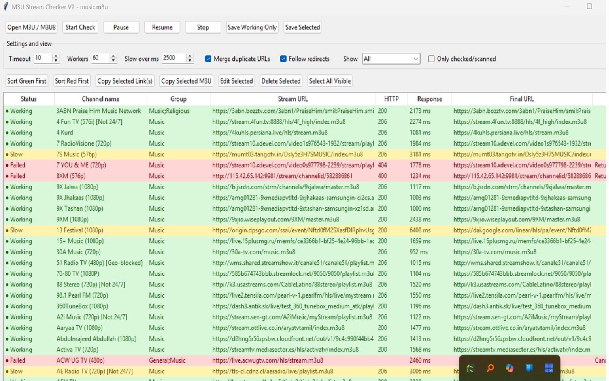

# 📡 M3U Stream Checker

**A Windows-friendly Python desktop utility to inspect, filter and export M3U / M3U8 playlist links.**

Created and maintained in [sacuar](https://github.com/sacuar)'s software collection. Contributions and bug reports are welcome.

[](https://www.python.org/)
[](CONTRIBUTING.md)
[](LICENSE)



## What it does

- Open local M3U / M3U8 playlists in a Tkinter desktop interface.
- Check streams concurrently with configurable timeout and worker counts.
- Classify links as **Working**, **Slow**, **Failed**, **Waiting**, or **Checking**.
- Filter or sort by status, select channels, merge duplicate URLs and follow redirects.
- Save a playlist containing responding streams, or export only selected entries.

**Important:** An HTTP response does not guarantee that a live stream will play in VLC. Some streams require DRM, credentials, geographic access or a particular media player. This utility cannot bypass those restrictions. Avoid aggressive worker counts against third-party servers.

## Run from source

Requires Python 3 and Tkinter, plus the dependencies listed in `requirements.txt`.

```powershell
git clone https://github.com/sacuar/IPTV_stream_checker.git
cd IPTV_stream_checker
python -m pip install -r requirements.txt
python m3u_stream_checker.py
```

On Linux, Tkinter may need to be installed separately using the system package manager.

## Existing Windows executable

A historical packaged EXE is preserved as `M3U_Stream_Checker.exe` in the repository and an older build is referenced on the [releases page](https://github.com/sacuar/IPTV_stream_checker/releases/tag/IPTV-M3U-CHECK). Those binaries have **not** been rebuilt or manually validated as part of this documentation cleanup.

For a new Windows build, use `generateexe.bat` after checking its commands and installing Python. PyInstaller output goes into `build/` and `dist/`; those are **generated files**, not source code, and are excluded from future commits.

## Help improve this project

Useful contributions include accessible UI controls, more conservative stream-health checks, cancellation of long-running scans, robust M3U parsing, tests and packaging documentation.

[Report a bug](https://github.com/sacuar/IPTV_stream_checker/issues) · [Read contribution guidelines](CONTRIBUTING.md) · [Project source](m3u_stream_checker.py)

Please test changes with small playlists first, and avoid including private streams or access tokens in reports.

## Licence and credit

This repository includes the [GNU General Public License v3](LICENSE). Contributions should respect that licence and the terms of any third-party resources. Share credit for the original project when useful.

[☕ Optional creator support](https://buymeacoffee.com/sacuar)
